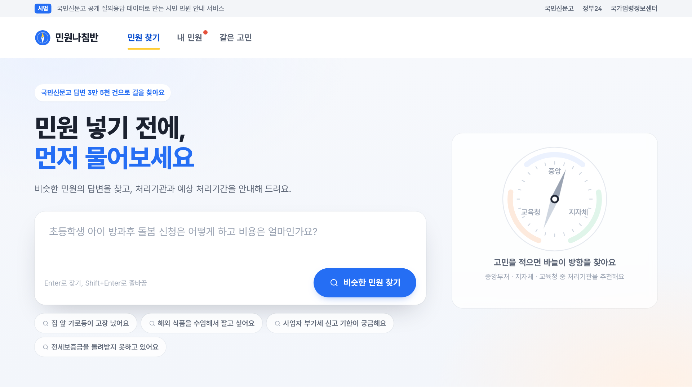
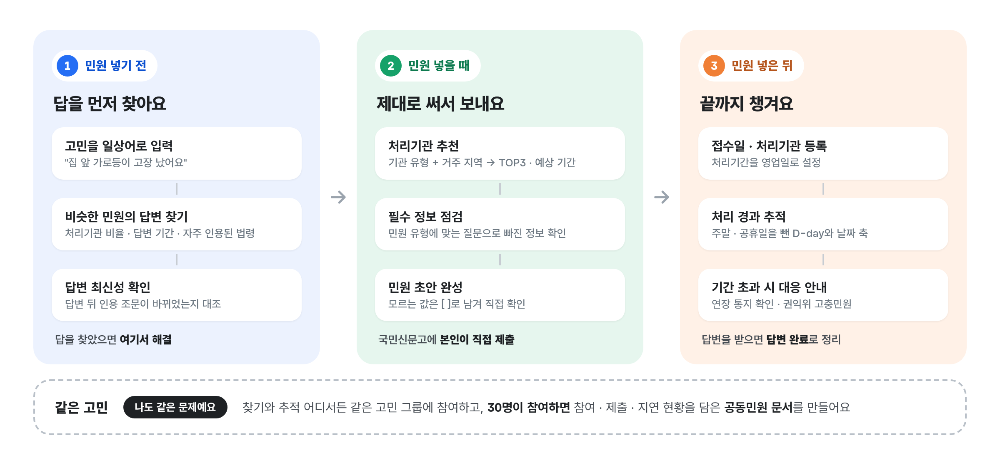
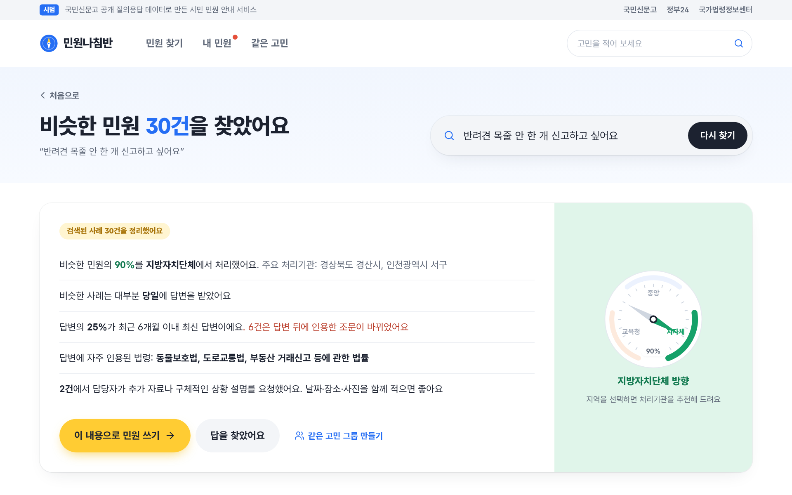
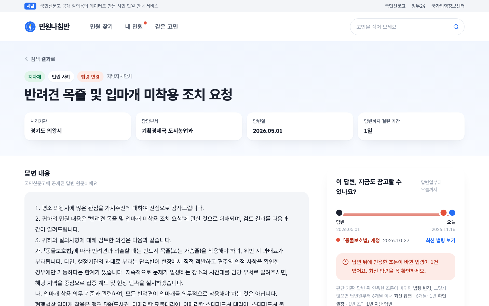
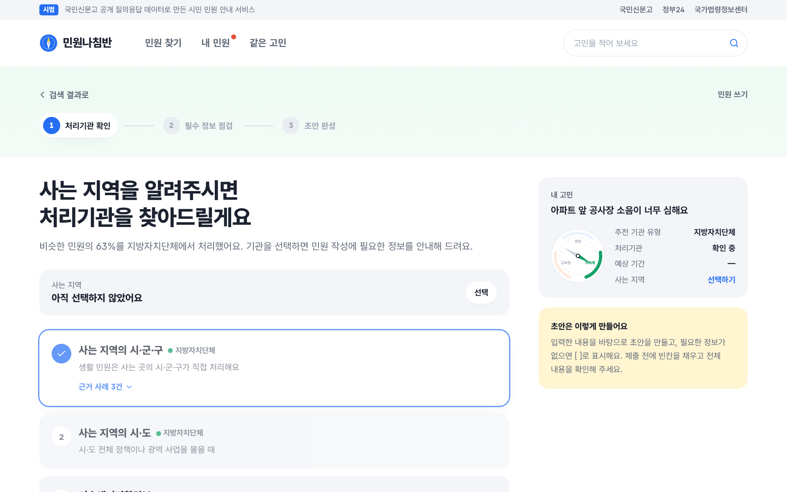
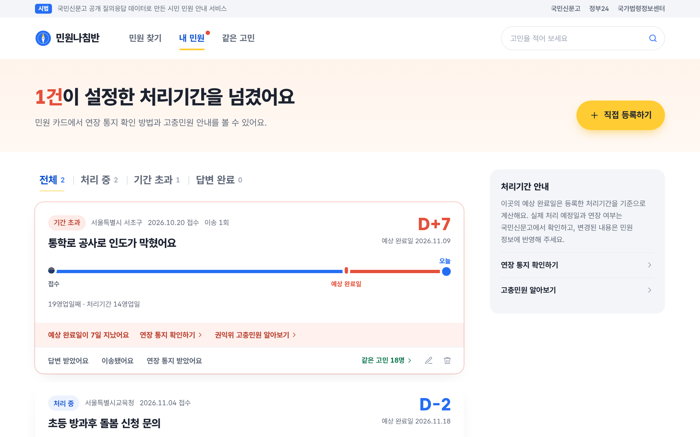
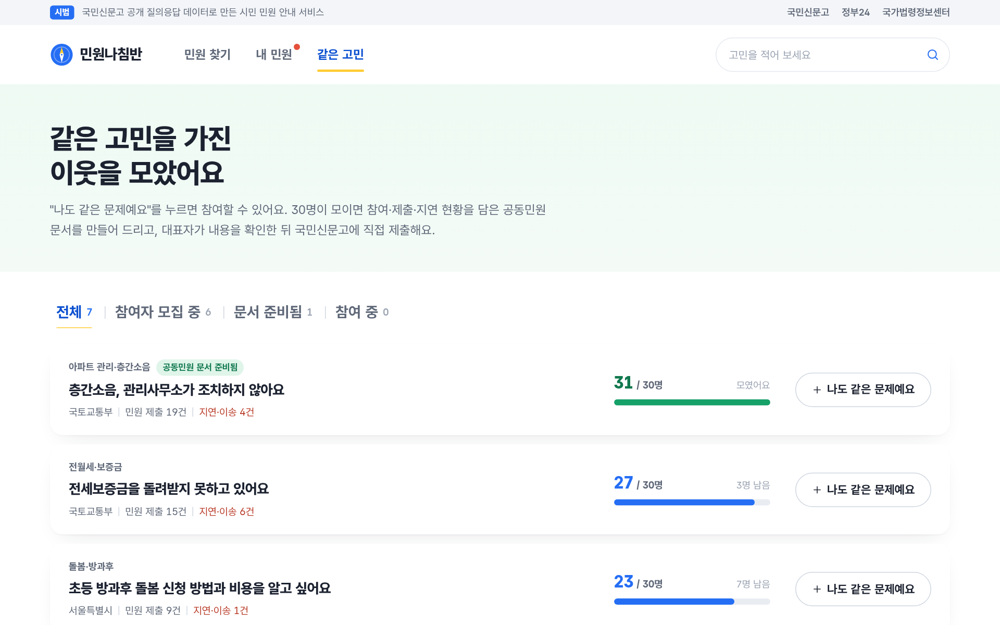
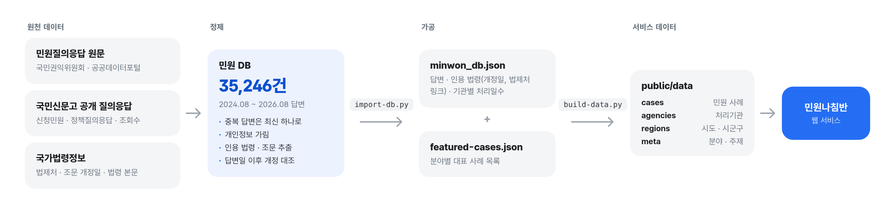

<div align="center">


# 민원나침반

### 민원 넣기 전, 비슷한 답변부터 확인하세요

국민신문고 답변 3만 5천 건을 바탕으로 비슷한 민원의 답변을 찾고,<br />
처리기관과 예상 처리기간, 민원 초안 작성, 제출 후 처리 경과 확인까지 돕는 시민용 민원 도우미

**[서비스 바로가기 → minwon-ax.vercel.app](https://minwon-ax.vercel.app)**

<br />


<br />



</div>

<br />

## 한눈에 보기

| 국민신문고 답변 | 처리기관 | 답변의 법령 인용 | 분야 · 주제 수 |
| :---: | :---: | :---: | :---: |
| **35,246건** | **385곳** | **28,209건** | **9개 · 27개** |
| 2024.08 ~ 2026.08 | 중앙 · 지자체 · 교육청 | 법령 3,075종, 법제처 자료로 법령 개정일 확인 | 주거 · 교통 · 돌봄 · 환경 등 |

<br />

## 왜 만들었나요

<table>
  <tr>
    <td width="300">
      <a href="https://www.yna.co.kr/view/AKR20261020087200001"></a>
    </td>
    <td>
      <a href="https://www.yna.co.kr/view/AKR20261020087200001"><b>"국민신문고 100일 이상 미처리 민원 5년간 2천건 넘겨"</b></a><br />
      <sub>연합뉴스 · 2026.10.21</sub><br /><br />
      국민이 정부와 공공기관에 제기한 민원이 3년 넘게 답변받지 못하거나, 담당 기관을 찾지 못해 10차례 이상 이곳저곳으로 떠넘겨지는 사례가 적지 않은 것으로 나타났다.
    </td>
  </tr>
</table>

| 100일 넘게 걸린 민원 | 100일 넘게 미처리 | 10회 이상 이송 | 5회 이상 이송 |
| :---: | :---: | :---: | :---: |
| **6,221건** | **2,220건** | **103건 → 252건** | **4,833건 → 7,911건** |
| 2022 ~ 2026.08 | 2026.08 말 기준 | 2022 → 2025 | 2022 → 2025 |

민원이 늦어지는 원인 가운데에는 **시민 쪽에서 미리 줄일 수 있는 부분**이 있습니다.

| 원인 | 민원나침반의 답 |
| --- | --- |
| 이미 답이 있는 질문을 다시 접수 | 넣기 전에 **비슷한 민원의 답변**을 먼저 보여 줘요 |
| 과거 답변이 지금도 맞는지 알 수 없음 | 답변이 인용한 **법령이 그 뒤에 바뀌었는지** 확인해 줘요 |
| 처리기관을 잘못 골라 이송 반복 | 비슷한 민원을 처리한 **기관 유형과 지역**으로 처리기관을 추천해요 |
| 지역·대상·시점이 빠진 민원 | 기관 유형에 맞는 **필수 정보를 점검**하고 초안을 만들어 줘요 |
| 내 민원이 늦어도 할 수 있는 게 없음 | **처리 경과를 추적**하고, 같은 고민을 가진 시민과 **함께 대응**해요 |

정부의 AI 국민신문고는 민원을 *처리하는 쪽*(공무원)을 돕습니다. 민원나침반은 같은 공공데이터로 민원을 *내는 쪽*(시민)을 돕습니다.

<br />

## 찾고, 쓰고, 끝까지 챙겨요



<table>
  <tr>
    <th width="33%">민원 넣기 전</th>
    <th width="33%">민원 넣을 때</th>
    <th width="33%">민원 넣은 뒤</th>
  </tr>
  <tr valign="top">
    <td>
      <b>① 비슷한 민원 찾기</b><br />
      일상어로 적은 고민과 비슷한 질의응답을 찾고, 처리기관·답변 기간·자주 인용된 법령을 한 장으로 정리해요
      <br /><br />
      <b>② 답변 최신성 확인</b><br />
      답변 뒤에 인용 법령이 바뀌었는지 대조해 <code>법령 변경</code> <code>최신 답변</code> 같은 배지로 알려 줘요
    </td>
    <td>
      <b>③ 처리기관 추천</b><br />
      비슷한 민원을 처리한 기관 유형을 추정하고, 거주 지역을 반영해 처리기관 TOP3와 예상 처리기간을 보여 줘요
      <br /><br />
      <b>④ 필수 정보 점검 · 초안</b><br />
      민원 유형에 맞는 질문으로 빠진 정보를 확인하고, 모르는 값은 <code>[ ]</code>로 남긴 초안을 만들어요
    </td>
    <td>
      <b>⑤ 내 민원 추적</b><br />
      접수일부터 영업일을 세어 D-day로 보여 주고, 기간을 넘기면 연장 통지 확인·고충민원 경로를 안내해요
      <br /><br />
      <b>⑥ 같은 고민</b><br />
      같은 문제를 겪는 시민이 30명 참여하면 참여·제출·지연 현황을 담은 공동민원 문서를 만들어요
    </td>
  </tr>
</table>

<br />

## 화면

<table>
  <tr>
    <td width="50%"></td>
    <td width="50%"></td>
  </tr>
  <tr>
    <td><b>비슷한 민원 찾기</b><br />검색된 사례를 한 장으로 요약하고, 나침반 바늘이 처리기관 유형을 가리켜요</td>
    <td><b>사례 상세</b><br />답변 원문과 인용 법령, 답변일 → 법령 개정일 → 오늘로 이어지는 최신성 타임라인</td>
  </tr>
  <tr>
    <td></td>
    <td></td>
  </tr>
  <tr>
    <td><b>민원 쓰기</b><br />처리기관 확인 → 필수 정보 점검 → 초안 완성 3단계</td>
    <td><b>내 민원</b><br />접수·예상 완료일·오늘을 잇는 날짜 축과 기간 초과 시 대응 안내</td>
  </tr>
  <tr>
    <td colspan="2"></td>
  </tr>
  <tr>
    <td colspan="2"><b>같은 고민</b><br />같은 문제를 겪는 이웃의 참여 현황을 모아 공동민원으로 이어 줘요</td>
  </tr>
</table>

<br />

## 데이터

### 어디서 왔나요

| 데이터 | 제공 | 쓰임 |
| --- | --- | --- |
| 국민신문고 민원질의응답 원문데이터 | 국민권익위원회 · 공공데이터포털 | 질문·답변·처리기관·부서·신청일·답변일 |
| 국민신문고 공개 질의응답 | 국민권익위원회 국민신문고 | 신청민원·정책질의응답, 조회수, 처리번호 |
| 국가법령정보 | 법제처 | 인용 법령의 조문 최종개정일·시행일·법령 본문 주소 |

두 원천을 하나의 민원 DB로 정제했어요. 같은 질문의 중복 답변은 최신 답변 하나로 묶고, 신청번호·전화번호·이메일·이름 같은 개인정보는 `[전화번호]`처럼 가렸어요.

### 데이터 흐름



- **`import-db.py`** 민원 DB 테이블을 읽어 답변마다 기관·부서·처리기간·조회수와 인용 법령(조문·개정일·법제처 링크)을 붙여요
- **`build-data.py`** 대표 사례와 주제별 표본을 골라 요약·주제 태그·기관 통계를 만들어 `public/data/`에 저장해요

### 어떤 사례를 담았나요

| 구분 | 고른 기준 |
| --- | --- |
| **분야별 대표 사례** | 분야마다 20건씩. 최근 답변, 법령을 인용한 답변, 시민 누구나 물을 만한 질문을 골랐어요 |
| **주제별 표본** | 원본의 주제 비율대로 27개 주제에 나눠 담고, 법령 인용·최근 답변·조회수가 높을수록 앞에 둬요 |
| **기관 균형** | 지자체·중앙행정기관·교육청 사례가 고루 보이도록 분야 안에서 번갈아 배치해요 |
| **사례 종류** | 시민이 묻고 기관이 답한 **민원 사례**와, 정책질의응답·기관 안내형 답변인 **공식 안내**로 나눠요 |

### 9개 분야, 27개 주제

| 분야 | 주제 |
| --- | --- |
| 주거 | 전월세·보증금 · 아파트 관리·층간소음 · 청약·분양 · 재개발·재건축 · 공공임대·주거복지 · 건축·용도변경 |
| 교통·주차 | 도로·보도 · 주차·불법주정차 · 버스·대중교통 · 자동차·검사 |
| 돌봄·교육 | 돌봄·방과후 · 학교·교육 |
| 환경·소음 | 소음·공사 · 쓰레기·폐기물 · 환경·대기 |
| 동네 시설 | 가로등·보안등 · 공원·녹지 |
| 안전·소방 | 소방·안전 · 산업안전·노동 |
| 세금·사업 | 세금·부가세 · 영업·인허가 · 수입식품·식품 |
| 복지·증명 | 복지·지원금 · 증명서·등록 · 민방위·병역 · 전기·에너지 |
| 반려동물 | 반려동물 |

<br />

## 핵심 로직

### 답변 최신성 판단

답변이 인용한 조문의 **최종개정일**을 답변일과 비교하고, 바뀐 내역이 없으면 답변이 나온 지 얼마나 됐는지로 판단해요.

| 배지 | 기준 |
| --- | --- |
| **법령 변경** (빨강) | 답변 뒤에 인용한 조문이 개정됨 (가장 먼저 적용) |
| **최신 답변** (민트) | 답변 후 6개월 이내 |
| **확인 권장** (노랑) | 답변 후 6개월 ~ 1년 |
| **1년 지난 답변** (회색) | 답변 후 1년 초과 |

법령 칩을 누르면 국가법령정보센터의 해당 법령 본문(법령·자치법규·행정규칙)으로 바로 이동해요.

### 처리기관 추천과 예상 처리기간

1. 비슷한 민원 상위 사례를 유사도로 가중해 **기관 유형**(중앙행정기관·지방자치단체·교육청)을 추정해요.
2. 중앙이면 비슷한 민원을 처리한 기관을 집계해 TOP3로, 지자체·교육청이면 **거주 지역**을 반영해 해당 시·군·구, 시·도, 교육청을 안내해요. (2026년 출범한 전남광주통합특별시와 지역별 교육청도 반영)
3. **예상 처리기간**은 그 기관 답변의 90%가 나온 법정 처리일수(영업일)로 계산해요.

### 비슷한 민원 찾기

- 한국어 정규화와 토큰화, 생활어 ↔ 행정어 동의어 확장(예: 층간소음 → 공동주택, 전세 → 임대차·보증금)
- 토큰 IDF 가중 점수와 제목 글자 바이그램 유사도를 함께 계산
- 결과는 민원 사례 / 공식 안내 탭, 기관 유형·최신성·법령 변경 필터, 비슷한 순·최신 답변순·많이 본 순 정렬

### 내 민원 추적

- 접수일부터 **영업일**(주말·공휴일 제외)을 세어 D-day와 예상 완료일을 계산
- 상태: 처리 중 · 기간 연장 · 이송됨 · 답변 완료, 기간을 넘기면 `기간 초과` 탭으로 모아 보기
- 입력한 정보는 서버로 보내지 않고 이용자 브라우저에만 저장

<br />

## 디자인

행정안전부 **범정부 디자인 시스템(KRDS)** 의 색·서체·접근성 기준에, 시민이 편하게 들어올 수 있는 밝은 공공 포털 톤을 더했어요.

| 원칙 | 적용 |
| --- | --- |
| 공공서비스 신호 | KRDS 정부 청색 `#256ef4`, KRDS 기본 서체 **Pretendard GOV**, 상단 서비스 식별 줄과 기관형 푸터 |
| 나침반 = 기관 유형 색 | 중앙 **청색** · 지자체 **민트** `#16a169` · 교육청 **살구** `#f07f36` — 배지·나침반·그래프가 같은 색을 공유 |
| 한 화면, 한 행동 | 가장 중요한 행동 하나만 노란 버튼 `#ffcc33`, 페이지마다 큰 숫자는 하나 |
| 정보는 글자로 | 장식 아이콘·이모지 대신 "조회 1,234", "답변까지 5일"처럼 글자 라벨, 단계는 ① ② ③ 번호 |
| 쉬운 말 | 해요체, 행정 용어 대신 생활어 ("처리 1일" → "답변까지 1일", "당일 답변") |
| 접근성 | 본문 바로가기, `main` 랜드마크, 키보드 포커스 표시, 숫자 정렬(`tnum`) |

<br />

## 구조

```
src/
├─ services/      데이터·도메인 로직 (실제 API로 바꿀 때 이 계층만 교체)
│  ├─ searchService.ts          비슷한 민원 찾기
│  ├─ lawService.ts             답변 최신성 · 법령 개정 확인
│  ├─ recommendationService.ts  기관 유형 추정 · 처리기관 TOP3
│  ├─ draftService.ts           필수 정보 점검 · 민원 초안
│  ├─ trackingService.ts        내 민원 추적 · 영업일 계산
│  ├─ groupService.ts           같은 고민 · 공동민원 문서
│  └─ insightService.ts         검색 결과 종합 안내 집계
├─ pages/         라우트별 화면 (찾기 · 상세 · 쓰기 · 내 민원 · 같은 고민)
├─ components/    ui · layout · brand(나침반) · cases · search · write · track · groups
├─ hooks/  context/  lib/      공통 훅 · 세션 · 한국어 텍스트 처리 · 영업일
└─ config/  types/             분야·주제 사전 · 타입
scripts/          민원 DB → 서비스 데이터 파이프라인 (Python)
public/data/      서비스가 읽는 JSON (cases · agencies · regions · meta)
```

화면 컴포넌트는 서비스 함수와 타입에만 의존해요. 서비스 내부를 서버 API로 바꿔도 화면 코드는 그대로 둘 수 있게 설계했어요.

| 서비스 | 지금 | 서버 연동 시 |
| --- | --- | --- |
| 비슷한 민원 찾기 | 브라우저 내 IDF·바이그램 검색 | 한국어 임베딩(BGE-M3) + 벡터DB |
| 법령 개정 확인 | 법제처 조회 결과를 데이터에 포함 | 국가법령정보 Open API 실시간 조회 |
| 민원 초안 | 기관 유형별 템플릿 | LLM 초안 작성 · 근거 설명 |
| 내 민원 · 같은 고민 | 브라우저 저장 | 서버 저장 · 참여 집계 |

<br />

## 실행하기

```bash
npm install
npm run dev          # 개발 서버 → http://localhost:5173
npm run build        # 타입 검사 + 프로덕션 빌드 → dist/
npm run preview      # 빌드 결과 미리보기
```

서비스 데이터를 다시 만들 때 (Python 3 필요)

```bash
# 민원 DB 테이블 CSV → data/minwon_db.json
python3 -I scripts/import-db.py <테이블_CSV 폴더>

# data/minwon_db.json → public/data/*.json
npm run data
```

`main` 브랜치에 올리면 Vercel이 자동으로 빌드·배포해요.

<br />

## 개발 과정

| 시기 | 한 일 |
| --- | --- |
| **기획** | 국민신문고 데이터 분석, 서비스 계획서와 UI 목업 작성, 찾기·쓰기·추적 6개 기능 설계 |
| **11.06** | React + TypeScript로 6개 화면 구현, 밝은 공공 포털 톤으로 디자인 정리 |
| **11.06** | KRDS 색·서체(Pretendard GOV)·접근성 기준 적용, 서비스 식별 줄과 기관형 푸터 |
| **11.09** | 첫 화면을 '찾기' 하나에 집중하도록 재구성, 내 민원·같은 고민 화면을 목록 중심으로 개편 |
| **11.13** | Vercel 배포 |
| **11.15** | 분야별 대표 사례 선정, 지자체·중앙·교육청 사례 비율 균형 조정 |
| **11.15** | 최신성 기준 재설계 (법령 변경 → 6개월 → 1년), 처리기간 문구를 "답변까지 N일"로 통일 |
| **11.15** | 서비스 데이터를 민원 DB 3만 5천 건 기준으로 통합, 법제처 자료로 조문 개정일 확인, 법령 본문 바로가기 연결 |

<br />

## 출처

- 국민권익위원회, 「국민신문고 민원질의응답 원문데이터」, 공공데이터포털 ([data.go.kr/data/15164540](https://www.data.go.kr/data/15164540/fileData.do))
- 국민권익위원회 국민신문고 ([epeople.go.kr](https://www.epeople.go.kr))
- 법제처 국가법령정보센터 ([law.go.kr](https://www.law.go.kr))
- 행정안전부 범정부 디자인 시스템 KRDS ([krds.go.kr](https://www.krds.go.kr)), Pretendard GOV (SIL Open Font License)

<br />

<div align="center">

**민원나침반** · 팀 주거니받거니

</div>
